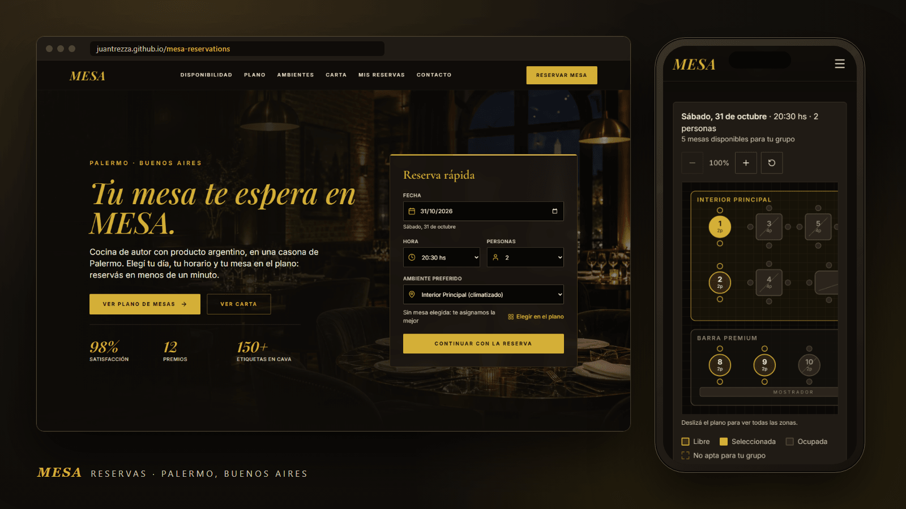
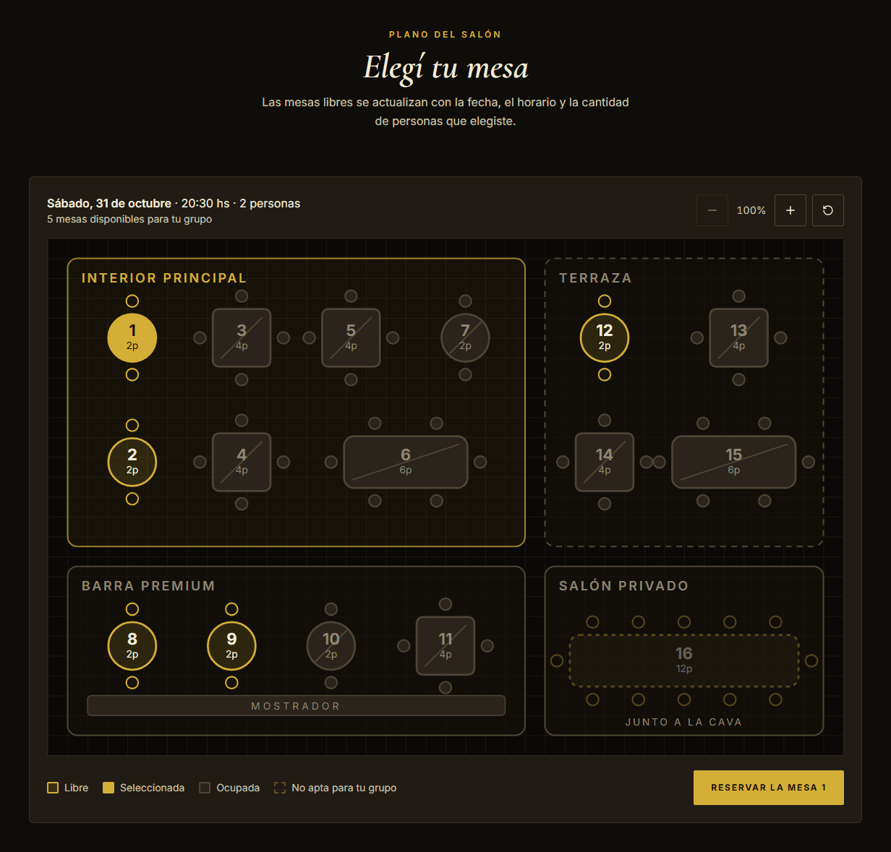
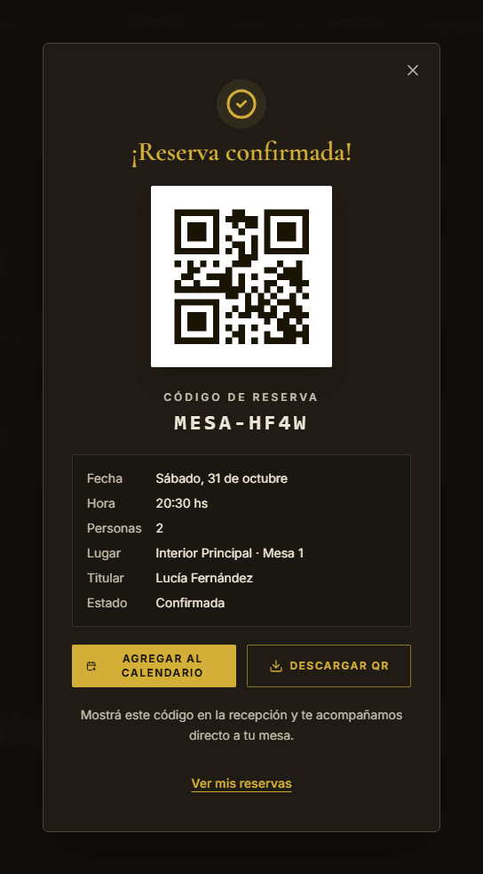
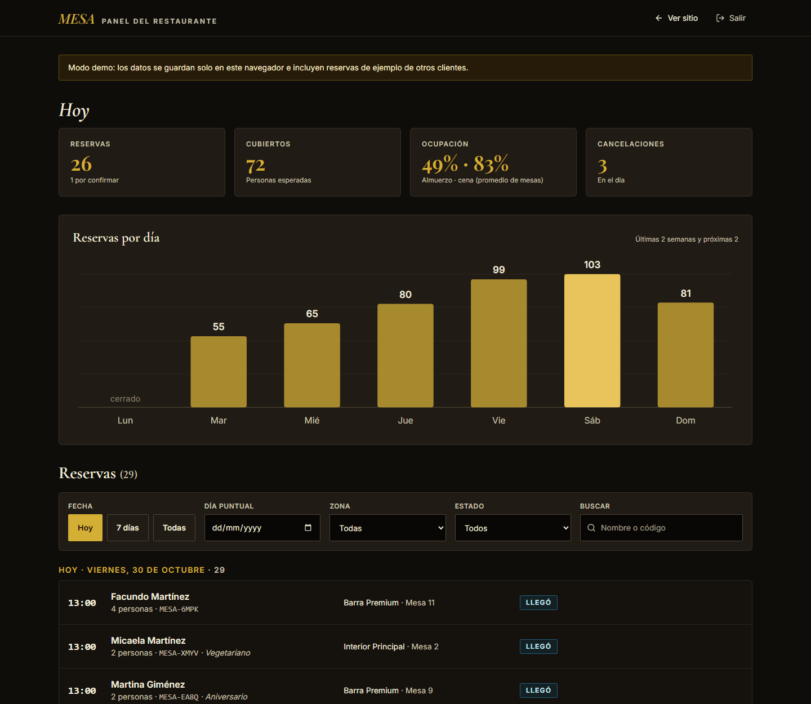

<div align="center">

# MESA

Sistema de reservas para un restaurante de autor en Palermo, Buenos Aires: elegís día, horario y mesa en un plano interactivo, y te llevás tu QR.

[](https://react.dev/)
[](https://www.typescriptlang.org/)
[](https://vite.dev/)
[](https://tailwindcss.com/)
[](https://motion.dev/)
[](https://playwright.dev/)

**[Ver demo en vivo →](https://juantrezza.github.io/mesa-reservations/)**



</div>

---

## Funcionalidades

### Reserva rápida y disponibilidad
- Formulario de fecha, horario, personas y ambiente, siempre sincronizado con el calendario y el plano.
- Calendario de los próximos 7 días con los turnos libres de almuerzo (12:30 a 14:30) y cena (20:00 a 22:30). Los lunes, cerrado.
- Los horarios llenos o que ya pasaron se muestran deshabilitados, calculados con las reservas reales.

### Plano de mesas interactivo
- Plano del salón en SVG con 16 mesas en cuatro zonas: Interior, Terraza, Barra y Salón privado.
- Cuatro estados: **libre**, **ocupada**, **seleccionada** y **no apta** para la cantidad de personas.
- La ocupación cambia con la fecha, el horario y las reservas guardadas (cada reserva bloquea la mesa 2 horas).
- Elegir una mesa completa la zona del formulario. Se maneja con teclado: cada mesa es un botón con su estado (`Mesa 7, 4 personas, Terraza, libre`).
- En el celular, el plano tiene zoom y scroll propios sin romper el layout.



### Confirmación con QR y calendario
- Código de reserva legible (por ejemplo `MESA-7K2P`) y un QR real generado con [`qrcode`](https://www.npmjs.com/package/qrcode).
- **Agregar al calendario** descarga un `.ics` con la reserva y un recordatorio 2 horas antes.
- **Descargar QR** genera un PNG imprimible con el código y los datos de la reserva.



### Mis reservas
- Próximas reservas e historial, con estado, mesa y código.
- **Cancelar** con confirmación en la misma tarjeta (sin `confirm()` nativo).
- **Repetir** precarga el formulario con las personas, la zona, el horario y los datos de contacto, y avisa con un toast.

### Panel del restaurante
- KPIs del día: reservas, cubiertos, ocupación por turno y cancelaciones.
- Gráfico de barras en SVG con las reservas por día de la semana.
- Filtros por fecha (hoy, 7 días, día puntual o todas), zona y estado, más búsqueda por nombre o código.
- Acciones **Confirmar**, **Llegó** y **Cancelar**. Los cambios se ven al instante en la parte pública.



### Accesibilidad
- Contraste WCAG AA en todo el sitio (axe-core sin violaciones en 320, 375, 768 y 1440 px).
- Zonas táctiles de al menos 44 px y sin scroll horizontal en mobile.
- Validación con mensajes debajo de cada campo, `aria-invalid` y `aria-describedby`, y el foco va al primer error.
- Diálogos con foco atrapado, cierre con Escape y devolución del foco al cerrar.
- Animaciones desactivadas con `prefers-reduced-motion`.

## Panel admin

Entrá a [`#/admin`](https://juantrezza.github.io/mesa-reservations/#/admin) o usá el link **Acceso restaurante** del footer. El PIN de demo es **`1234`** y se muestra en la misma pantalla de acceso.

> [!NOTE]
> Es una demo sin backend: el PIN no protege nada y los datos viven en el `localStorage` de tu navegador. Para empezar de cero, borrá los datos del sitio.

## Decisiones técnicas

- **Datos en `localStorage`.** No hay servidor: las reservas se guardan en el navegador. Para que el plano y el panel tengan movimiento, se generan reservas de ejemplo de otros clientes para las dos semanas anteriores y las dos siguientes. La generación es determinista por fecha y respeta la ocupación existente. La parte pública y el panel leen los mismos datos.
- **Reglas de capacidad por zona.** Interior y Terraza admiten hasta 6 personas, la Barra hasta 4, y el Salón privado es una mesa imperial para grupos de 6 a 12 que queda *pendiente* hasta que el restaurante la confirma. Cada mesa tiene un mínimo de comensales: no se asigna una mesa de 6 a una pareja. Sin mesa elegida, se asigna la más chica que alcance.
- **Validación en un solo lugar** (`src/lib/validation.ts`): fechas pasadas, lunes, turnos, horarios llenos, capacidad, nombre, email y teléfono argentino (acepta `+54 9 11…`, `011 15…`, etc.).
- **Carga diferida.** El panel admin (`React.lazy`), la librería del QR (`import()` al abrir el modal) y las animaciones (`LazyMotion`) van en chunks aparte, así la carga inicial no los descarga.
- **Fuentes optimizadas.** Google Fonts con `preconnect`, sin bloquear el render y solo con las 8 variantes que se usan.
- **Imágenes optimizadas.** WebP importadas con hash, versiones de 768 px para mobile (`srcset`), `width`/`height` para evitar saltos, `loading="lazy"` y precarga de la imagen principal con `fetchpriority="high"`.
- **Fechas en hora local.** `YYYY-MM-DD` se interpreta como fecha local: `new Date('2026-05-15')` la toma en UTC y en Buenos Aires mostraría el día anterior.

## Tests

Tests end-to-end con Playwright sobre el build de producción:

```bash
npx playwright install chromium   # solo la primera vez
npm run test:e2e
```

El comando compila el proyecto, levanta `vite preview` en el puerto 4174 y corre 15 tests en Chromium:

| Archivo | Qué cubre |
|---|---|
| `booking.spec.ts` | Elegir mesa en el plano (con mouse y con teclado), confirmar, descargar el `.ics` y el PNG del QR, ver la reserva en Mis reservas y que la mesa quede ocupada |
| `validation.spec.ts` | Fecha pasada, lunes, máximo de personas por zona, email y celular inválidos con `aria-invalid` y foco en el primer error |
| `cancel-repeat.spec.ts` | Cancelar sin diálogos nativos y repetir con el formulario precargado |
| `admin.spec.ts` | PIN incorrecto y correcto, KPIs, filtros por zona, estado y nombre, cambio de estado y datos compartidos con la parte pública |
| `responsive.spec.ts` | Sin scroll horizontal en 375 y 1440 px, en el sitio y en el panel |

## Lighthouse

Build de producción en local, Lighthouse 13.6, mediana de 3 corridas (30/10/2026):

| | Performance | Accesibilidad | Buenas prácticas | SEO |
|---|:---:|:---:|:---:|:---:|
| **Mobile** | 78 | 100 | 100 | 100 |
| **Escritorio** | 99 | 100 | 100 | 100 |

En mobile, Performance varía entre 74 y 81 según la corrida (LCP 3,3 s, CLS 0). Lo que más pesa es el tiempo de render de React en un celular simulado con la CPU 4× más lenta; para mejorarlo habría que prerenderizar el HTML.

## Correr en local

Requisitos: Node.js 18 o superior.

```bash
npm install
npm run dev        # http://localhost:3000/mesa-reservations/
```

| Script | Para qué |
|---|---|
| `npm run dev` | Servidor de desarrollo |
| `npm run build` | Build de producción en `dist/` |
| `npm run preview` | Sirve el build localmente |
| `npm run lint` | Chequeo de tipos con TypeScript |
| `npm run test:e2e` | Tests end-to-end con Playwright |
| `npm run docs:screenshots` | Regenera las capturas de `docs/` |

### Regenerar las capturas

`docs:screenshots` saca las capturas del build servido localmente, así que **requiere `npm run build` y `npm run preview` en el puerto 4173**:

```bash
npm run build
npm run preview              # deja el servidor en http://localhost:4173/mesa-reservations/
npm run docs:screenshots     # en otra terminal
```

Las reservas de ejemplo son relativas a la fecha del día, así que las capturas cambian según cuándo se generen.

Cada push a `main` se publica en GitHub Pages con GitHub Actions (`.github/workflows/deploy.yml`).

## Estructura

```
mesa-reservations/
├── docs/                  # Capturas del README
├── public/                # Favicon e imagen Open Graph
├── scripts/docs.mjs       # Genera las capturas de docs/
├── src/
│   ├── admin/             # Panel del restaurante (se carga aparte)
│   ├── assets/images/     # Fotos en WebP (1536 px y 768 px)
│   ├── components/        # Secciones del sitio, plano de mesas, diálogos y formularios
│   ├── lib/
│   │   ├── booking.ts     # Turnos, zonas, fechas, formato ARS y códigos de reserva
│   │   ├── floorplan.ts   # Mesas, geometría del plano y ocupación
│   │   ├── storage.ts     # localStorage y reservas de ejemplo
│   │   ├── validation.ts  # Reglas del formulario
│   │   └── ics.ts         # Archivo de calendario
│   ├── App.tsx            # Estado de la reserva, diálogos y ruta #/admin
│   └── types.ts
├── tests/e2e/             # Tests de Playwright
├── playwright.config.ts
├── tailwind.config.js     # Tokens de color y tipografías del tema
└── vite.config.ts
```

## Autor

Hecho por **Juan Trezza** · [Portfolio](https://juantrezza.github.io/porfolio) · [GitHub](https://github.com/JuanTrezza)
